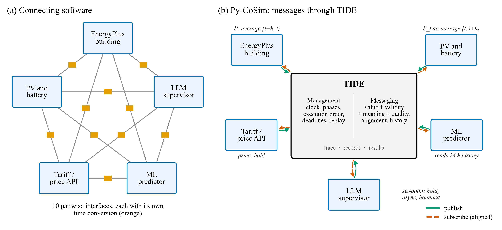

# Py-CoSim

**Python co-simulation for buildings and everything around them.**

Py-CoSim couples [EnergyPlus](https://energyplus.net) building models with any
other Python model — weather data, PV, batteries, tariffs and grids, occupancy
and travel-behaviour models, machine-learning predictors, large language models
(LLMs) and reinforcement-learning agents — on one synchronized clock, with a
few lines of plain Python.

Components never call each other. They publish **messages** to TIDE, the
Time-aware Interval Data Exchange, and subscribe to what they need.
Every message says what its time stamp means (a sample, an interval average, an
amount, a value held until replaced, or an event), so TIDE can align data
between components that run at different step sizes, flag invalid values,
record AI decisions for exact replay, and deliver the answers of slow AI
services at a declared simulation time.

[](https://github.com/lz356/Py-CoSim/actions/workflows/ci.yml)

-orange)
[](LICENSE)



```python
import pycosim as pc
from pycosim.components import TimeOfUseTariff

@pc.component(outputs="clg_sp")                        # any Python function is a component
def precool(t, price=0.1):
    return 22.0 if 13 <= t.hour < 16 else (26.5 if price > 0.2 else 24.0)

sim = pc.CoSimulation(start="2023-07-17", end="2023-07-24", step="15min")
office = sim.add(pc.EnergyPlusComponent(                # EnergyPlus as a steppable component
    "office", "small_office.idf", "tucson.epw",
    sensors={"T_zone": ("Zone Mean Air Temperature", "Core_ZN")},
    meters={"P_elec": ("Electricity:Facility", "W")},
    actuators={"clg_sp": ("Schedule:Compact", "Schedule Value", "CLGSETP_SCH")},
))
sim.add(TimeOfUseTariff("tariff"), precool)
sim.connect("tariff.price", "precool.price")
sim.connect("precool.clg_sp", "office.clg_sp")
meter = sim.add(pc.components.GridMeter("meter"))       # reads power and price over the step that just ended
sim.subscribe("meter.P_load", "office.P_elec")
sim.connect("tariff.price", "meter.price")
results = sim.run(progress=True)                        # pandas DataFrame in results.df
```

## Why Py-CoSim?

| | |
|---|---|
| **Messages that know their time** | Each output declares whether it is an `instant` sample, an interval `average` or `amount`, a `hold` value or an `event`; each input asks for the value `at` its time, or over the step that just ended (`past`) or starts (`ahead`). TIDE aligns them: an hourly meter reading 15-min EnergyPlus power gets the exact hourly mean, and energy is charged at the price of its own interval. |
| **AI-ready messaging** | Bounds and fallbacks with a quality flag on every message; record/replay of any component for bit-identical reruns and counterfactuals; provenance trace (`results.lineage(...)`); asynchronous components whose answers apply after a declared decision delay, whatever the service's latency. |
| **Pure Python** | No Modelica, Ptolemy, MATLAB or middleware. If you can write a Python function, you can write a co-simulation component. |
| **EnergyPlus made steppable** | Py-CoSim inverts EnergyPlus' callback-driven loop into a lock-step component (`output` → exchange → `update`), with time-stamp checks every step. Results are **bit-identical** to stand-alone EnergyPlus. |
| **Correct by construction** | A graph-based master algorithm orders components automatically, detects algebraic loops, supports multi-rate components, subscriptions by pattern (`"bldg*.P_facility"`) or topic, fan-in aggregation, delayed (Jacobi) links, and reproducible randomness. EnergyPlus can run a finer internal step than the exchange step. |
| **Scales across buildings** | Every EnergyPlus instance runs in its own worker process — parallel, isolated and crash-safe (EnergyPlus is not thread-safe). |
| **Batteries included** | Weather (EPW), solar position, PV, battery, time-of-use tariffs, grid metering, thermostats, pre-cooling, PI and peak-shaving controllers, a 2R2C building model, NHTS travel-behaviour occupancy, LLM supervisors, an FMU adapter (FMI 2.0/3.0 co-simulation), Gymnasium RL interface. |
| **Practical tooling** | `pycosim handles` lists every sensor/actuator a model offers (with "did you mean" suggestions for typos), `pycosim run scenario.yaml` runs YAML scenarios, live plots, event logs, error reports, results as tidy DataFrames. |
| **Auditable AI-in-the-loop** | LLM decisions pass through guardrails (parse → validate → clip → rate-limit → fall back) and every prompt/response is logged; record & replay makes runs reproducible. |

## Installation

```bash
git clone https://github.com/lz356/Py-CoSim.git
cd Py-CoSim
pip install -e ".[all]"        # or just `pip install -e .` for the core
pycosim doctor                 # checks Python packages and finds EnergyPlus
```

Install [EnergyPlus](https://energyplus.net/downloads) ≥ 9.4 (developed and tested with 22.2) if you want to
co-simulate EnergyPlus models. Py-CoSim finds it automatically in the standard locations, or set
`ENERGYPLUS_DIR`. Everything else (examples 01, 07, 08, 09 and the test-suite core) runs without EnergyPlus.
See [docs/installation.md](docs/installation.md).

## Examples

Eleven runnable, commented examples — run any of them from the repository root, e.g.
`python examples/01_quickstart_no_energyplus/run.py`.

| # | Example | What you learn | EnergyPlus |
|---|---|---|---|
| 01 | [Quick start](examples/01_quickstart_no_energyplus/run.py) | RC house + weather + tariff + a thermostat function | – |
| 02 | [EnergyPlus basics](examples/02_energyplus_basics/run.py) | sensors, meters, actuators, live plotting | ✔ |
| 03 | [Time-of-use pre-cooling](examples/03_tou_precooling/run.py) | comparing control strategies, cost and comfort KPIs | ✔ |
| 04 | [Grid-interactive community](examples/04_community_pv_battery/run.py) | 10 parallel EnergyPlus buildings + community PV + battery + coordinator | ✔ |
| 05 | [LLM supervisory control](examples/05_llm_supervisor/run.py) | Claude / OpenAI / Ollama in the loop with guardrails, fault injection, record & replay | ✔ |
| 06 | [Travel behaviour → occupancy](examples/06_travel_behavior_occupancy/run.py) | NHTS household diaries drive 23 apartments; smart vs fixed thermostats | ✔ |
| 07 | [Reinforcement learning](examples/07_reinforcement_learning/run.py) | Gymnasium environment around any co-simulation | optional |
| 08 | [YAML scenario](examples/08_yaml_scenario/scenario.yaml) | a whole co-simulation without writing a script (`pycosim run`) | optional |
| 09 | [Write your own component](examples/09_custom_component_ev/run.py) | an EV charger with state, randomness and event logging | – |
| 10 | [FMU component](examples/10_fmu_component/run.py) | a Modelica-style FMU coupled with Python components (FMU-optional design) | – |
| 11 | [Messages and time](examples/11_messages_and_time/run.py) | time meanings, aligned metering, an asynchronous AI stand-in, record/replay, lineage | – |

## How it works

Every master step `t → t + Δt` has four phases:

```
 ┌────────────── phase 0: deliver ─────────────┐   answers of asynchronous components (e.g. LLM calls
 │ slow answers due at t are published          │   started earlier) take effect at their declared time
 └─────────────────────────────────────────────┘
 ┌────────────── phase 1: output ──────────────┐   state-based components (EnergyPlus, RC model, ...)
 │ EnergyPlus workers report their state at t  │   publish outputs that depend only on their state
 └─────────────────────────────────────────────┘
 ┌────────────── phase 2: step ────────────────┐   feedthrough components (controllers, PV, tariffs,
 │ topological order of the data-flow graph     │   ML/LLM agents, ...) compute outputs from inputs at t
 └─────────────────────────────────────────────┘
 ┌────────────── phase 3: update ──────────────┐   state-based components receive their inputs and
 │ all EnergyPlus workers advance in parallel   │   advance to t + Δt
 └─────────────────────────────────────────────┘
```

Values exchanged at time `t` are exactly the values EnergyPlus reports with time stamp `t` (the mean over
`[t − Δt, t)`); actuator values set at `t` act on the interval `[t, t + Δt)`. Every message is stored by TIDE with
its validity interval and quality, so inputs can be aligned, histories queried, runs replayed and decisions traced.
Read [docs/concepts.md](docs/concepts.md) and [docs/tide.md](docs/tide.md) for details.

## Documentation

* [Installation](docs/installation.md) · [Concepts](docs/concepts.md) · [Messages and time (TIDE)](docs/tide.md) · [Writing components](docs/writing-components.md)
* [EnergyPlus guide](docs/energyplus.md) · [Component library](docs/component-library.md) · [AI & RL](docs/ai-and-rl.md)
* [Scenarios, CLI, observers & results](docs/scenarios-and-cli.md) · [Examples](docs/examples.md) · [FAQ](docs/faq.md)
* [Migrating from Py-CoSim 0.x](docs/migration-from-0.x.md)

## Verification

`paper/experiments/` contains the scripts behind the accompanying article:
EnergyPlus run inside Py-CoSim reproduces stand-alone EnergyPlus **exactly** (maximum absolute difference 0.0 over
all reported series); a Python controller acting through an EMS actuator reproduces the equivalent EnergyPlus schedule
exactly; parallel multi-building runs are bit-identical to serial runs. Further scripts quantify the error of
naive vs. aligned exchange, record/replay with a stochastic AI supervisor, asynchronous AI calls, and a
comparison with HELICS (`paper/experiments/run_all_paper.sh`). Run the test-suite with `pytest`
(EnergyPlus tests are skipped automatically when EnergyPlus is not installed).

## Citing

If Py-CoSim helps your research, please cite the software (see [CITATION.cff](CITATION.cff)) and the accompanying
article (under review). The original concept was introduced in: Zhang L., Haroon S.M., Ryan A. (2023)
*Py-CoSim: Python-based building energy co-simulation infrastructure*. SSRN 4572925.

## Version history

Py-CoSim 2.1 redesigns TIDE around time-aware messages; code that uses `connect` without `read=` behaves as
in 2.0, except that `GridMeter` now prices energy with the price of its own interval (see the
[CHANGELOG](CHANGELOG.md)). Py-CoSim 2.0 was a complete rewrite. The original notebook-based version 0.x is preserved in the git tag
[`v0.1-legacy`](https://github.com/lz356/Py-CoSim/tree/v0.1-legacy); see the [migration guide](docs/migration-from-0.x.md)
and [CHANGELOG](CHANGELOG.md).

## License

MIT — see [LICENSE](LICENSE). The example building models are U.S. DOE reference/prototype models distributed with
EnergyPlus; the weather file is a TMY3 file; NHTS data are public data of the U.S. Federal Highway Administration
(see [examples/models/README.md](examples/models/README.md) and [tools/nhts](tools/nhts)).
