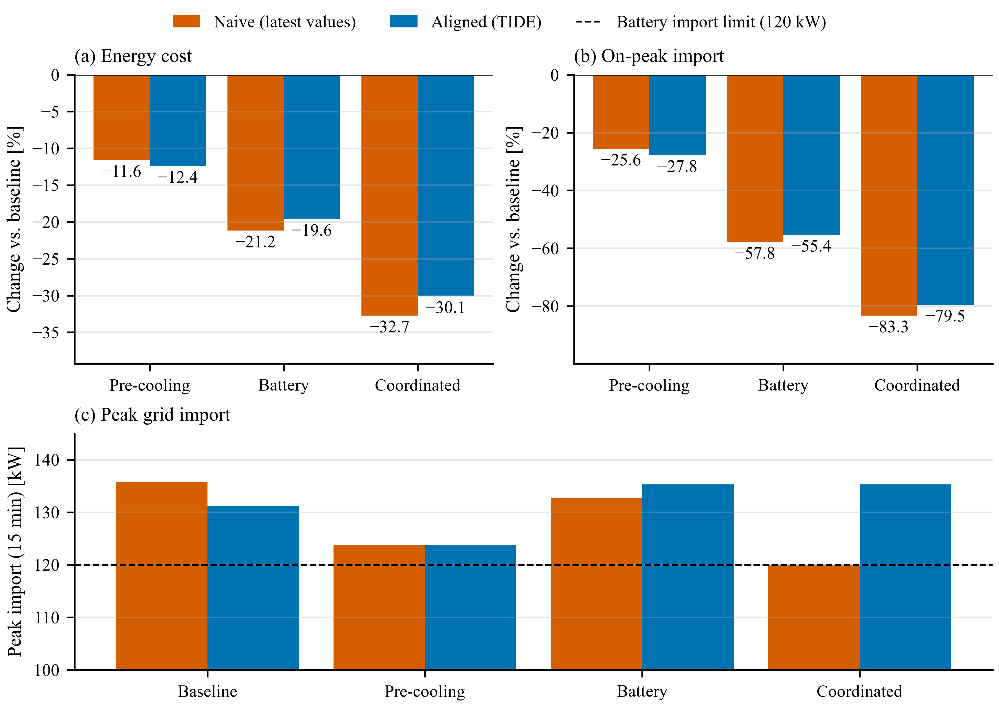

## What the time meaning of messages buys

The experiments show that a large share of the error of a building co-simulation can come from the exchange of data rather than from the models: charging energy at the wrong price interval, adding a power that describes the coming step to one that describes the past step, or sampling a fast signal with a slow consumer. These errors are known in principle [@kubler2000; @gomes2018], but in practice they are hidden in wiring code and rarely quantified. Making the time meaning part of every message has three consequences. First, the correction is declared once per port instead of being written once per connection, so a component brought into a new co-simulation carries its semantics with it, as a CF-compliant data file does [@cf2023]. Second, TIDE converts piecewise-constant and piecewise-linear signals exactly, which removed the interval-mismatch error whenever the consumer was not faster than the producer (@sec:e2a). Third, the conditions under which alignment is impossible, a consumer that needs a value no producer has published yet, become visible in the alignment report instead of silently producing a biased number.

Alignment does not make an explicit co-simulation exact. TIDE aligns the data a component reads; it does not iterate between components or roll them back, so the physical coupling error of a feedback loop that is closed only every exchange step remains. Energy-residual methods such as the nearly energy-preserving coupling element and power bonds address that error and are complementary [@benedikt2013nepce; @sadjina2017]. Within a consumer's step, TIDE can only deliver aggregates: the product of a rapidly changing price and a rapidly changing load needs a consumer step at least as fine as the price changes (@sec:e2a).

{#fig:case}

## A pitfall: the EnergyPlus time step changes the equipment

The standalone runs of @sec:e2b showed that the EnergyPlus time step changed the weekly electricity use of the small office by up to 14 %, almost entirely because the model's autosizing window is counted in time steps. Any study that changes the EnergyPlus time step should therefore fix the sizing window or hard-size the equipment. The sub-step option of the EnergyPlus adapter avoids the question: EnergyPlus keeps the time step and sizing for which the model was prepared, while components exchange data at whatever step they need. It is a matter of accuracy and flexibility, not of speed.

## Compatibility with AI and generative AI applications

Py-CoSim is not specific to AI, but its message model makes it compatible with AI and generative AI applications for four reasons. First, every input declares a window, so an ML predictor can read a history of aligned features instead of a single value. Second, quality flags with bounds and fallbacks, together with the JSON validation of the LLM supervisor, keep an invalid or refused answer from reaching a physics model unchecked, and every such case is counted. Third, record and replay makes a non-deterministic component repeatable at the cost of a JSON-lines file and separated a retrofit effect from a supervisor's randomness (@sec:e3); a replay holds the decisions fixed, however, and does not tell what a supervisor would have decided in the modified system. Fourth, asynchronous execution makes the latency of a service a modeling decision (the decision delay) instead of an accident of the computer; overlapping the calls of several components reduced the wall-clock time by up to 2.9 times, and results stay independent of latency as long as no deadline is missed, with misses flagged. The LLM supervisor works with hosted or local models through interchangeable back ends, and a Gymnasium environment serves reinforcement learning (@sec:impl).

## Limitations

The evaluation uses stand-ins for LLM services that imitate sampling and latency; the infrastructure claims do not depend on the quality of the answers, but a study with real AI models is still needed to report realistic latency distributions and failure rates. All experiments run on one computer with EnergyPlus 22.2, and asynchronous components run in threads, which suits remote services better than compute-bound local models. TIDE runs in one Python process, with EnergyPlus instances in worker processes; distributing components over several machines, as HELICS and HLA do, and connecting components written in other languages are left for future work, as is exchanging units along with time meanings. The comparison with HELICS covers one scenario and measures what a typical user would write in each tool, not the best that each tool can do.

# Conclusions {#sec:conclusions}

This paper presented Py-CoSim, a co-simulation framework in which every message states its time meaning and validity interval, every consumer states the window it needs, and the time-aware hub, TIDE, aligns, checks, records and traces the data and decides when the answers of slow components take effect. The main findings are:

@@CONCLUSION_LIST@@

Building co-simulation increasingly brings together physics models, data and AI services that were never designed to work together. Agreeing on what exchanged values mean in time is a small step that removes a whole class of errors and makes the remaining ones visible. The source code, examples and all experiment scripts are openly available at https://github.com/lz356/Py-CoSim.
