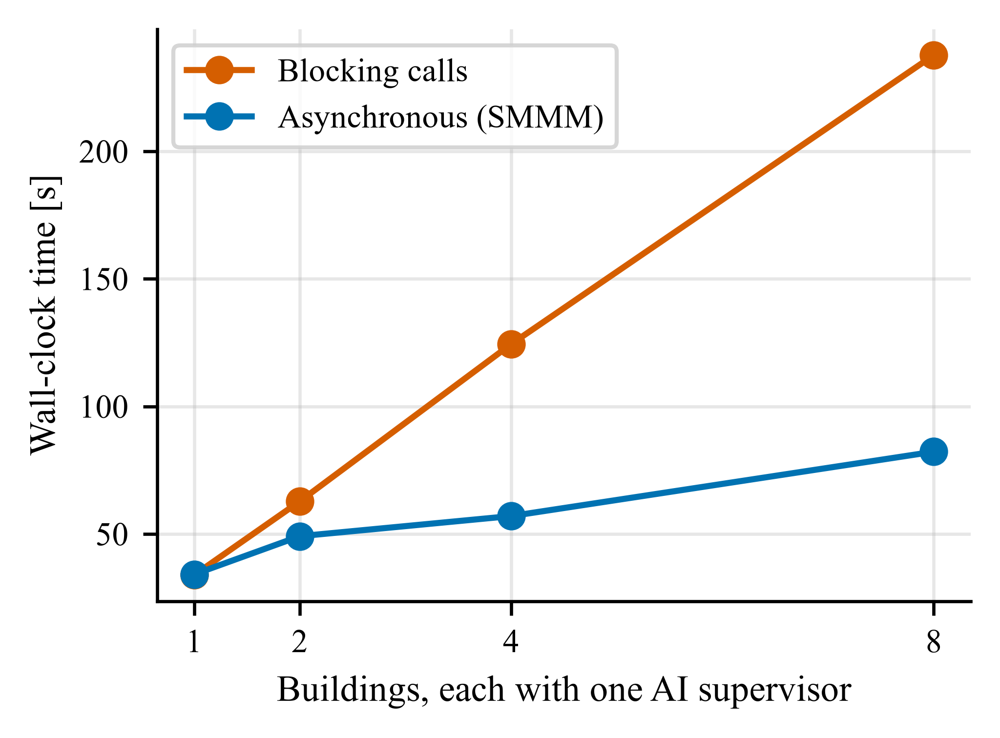

# Abstract {-}

Building energy models are increasingly co-simulated with photovoltaic systems, batteries, tariffs, occupant and machine-learning models, and large language model agents. Co-simulation tools connect such programs but exchange values as numbers stamped with an instant, leaving users to decide which interval each value belongs to, and offer no rules for artificial intelligence (AI) components that answer differently on every call, return invalid values or respond slowly. This paper redesigns the Simulation Management and Messaging Module (SMMM) of the open-source Py-CoSim framework into a time-aware message hub. Each message states whether its value is an instantaneous sample, an interval average, an interval amount, a value held until replaced or an event, and each input declares the window it needs. SMMM aligns the data automatically, flags their quality, records them for exact replay, traces their provenance and delivers the answers of slow components at a declared simulation time. EnergyPlus is coupled through its Python interface. Co-simulated EnergyPlus results were identical to standalone runs. Aligned exchange computed energy and cost exactly when a consumer's step was a multiple of its producer's, whereas exchanging latest values erred by up to 6 %. In a ten-office community with photovoltaics and a battery, naive exchange overstated the battery's peak reduction (peak import 120 kW instead of 135 kW). Replay reproduced runs with a stochastic AI supervisor exactly and cut the spread of a retrofit-savings estimate 24-fold; asynchronous delivery shortened runs with eight slow AI supervisors 2.9-fold without changing results.

# Introduction {#sec:intro}

Buildings are no longer simulated alone. Studies of grid-interactive efficient buildings couple a building energy model with photovoltaic (PV) generation, batteries, electric vehicles, tariffs and grid signals [@neukomm2019; @hong2025]. Occupant models, machine-learning (ML) predictors and, increasingly, large language models (LLMs) take part in the control loop [@wang2020; @ahn2023; @zhangchen2024; @liu2025llm]. No single program models all of this. Co-simulation, the coupled execution of separate models that exchange data at run time, is therefore the standard way to study such systems [@gomes2018; @hong2018].

Most co-simulation infrastructure is organized around connecting software. The Functional Mock-up Interface (FMI) packages a model behind a standard programming interface [@blochwitz2011; @junghanns2021]. The Building Controls Virtual Test Bed (BCVTB) and EnergyPlus's External Interface link EnergyPlus to other programs through sockets [@wetter2011; @nouidui2014]. Spawn of EnergyPlus couples Modelica with EnergyPlus [@wetter2020]. Gym-style environments such as Sinergym, COBS and BOPTEST wrap a building model for reinforcement learning [@jimenez2021; @zhang2020cobs; @blum2021]. Message-based frameworks such as HELICS and mosaik let simulators publish and subscribe to values through a broker or scheduler [@palmintier2017; @hardy2024; @steinbrink2019; @ofenloch2022]. In all of these tools, an exchanged value is a number stamped with a time instant. What that number means in time is left to the person who wires the models together.

This matters more than it seems, for two reasons. The first is time meaning. EnergyPlus reports a zone temperature or an electric power for a time step as an average over the step that has just ended, and an energy as a sum over it [@doe2024rdd]. A tariff or a set-point, by contrast, is valid from its time stamp until it is replaced. A battery command applies to the step that starts. When components with different step sizes exchange such values as bare numbers, the receiving component must know which interval each value belongs to and convert it. If it does not, energy is attributed to the wrong price interval, slow consumers sample fast signals, and fast consumers re-use stale values. These are the classical alignment and extrapolation errors of explicit (non-iterative) coupling [@kubler2000; @gomes2018], and they are usually fixed by hand for each connection [@tripakis2015; @gomes2019semantic].

The second reason is that AI components behave differently from physics models. A physics model is deterministic, fast, always returns a valid number, and needs only its current inputs. A hosted LLM may answer the same prompt differently on each call, even at temperature zero [@ouyang2025]. It may time out, refuse, or return text that is not a valid control signal. One call can take seconds while a building time step takes milliseconds [@neubauer2026]. An ML predictor needs a history of features rather than a single value. Reinforcement-learning results are notoriously hard to reproduce [@henderson2018]. A co-simulation that contains such components needs rules for reproducing a run, for rejecting invalid values, and for deciding when a slow decision takes effect. Recent studies of LLM-based building control call the model synchronously inside the loop or offline, and a 2026 review lists bounded latency, physics guardrails and reproducibility as open needs [@neubauer2026].

Py-CoSim was introduced as a Python co-simulation infrastructure that couples EnergyPlus through its Python application programming interface (API) with non-building components such as weather data, ML models and an LLM [@zhang2023]. Its Simulation Management and Messaging Module (SMMM) acted as a data hub: components published their results to it and read what they needed, without knowing each other. That first version exchanged data through one CSV file per component and time step and attached no meaning to the time stamps. The present paper keeps the idea of a message hub and develops it into a time-aware co-simulation method. Instead of asking how to connect program A to program B, every component publishes messages that state what their time stamps mean, and SMMM aligns them to what each receiving component needs.

The contributions are:

1. A message model in which every exchanged value carries its time meaning (an instantaneous sample, an interval average, an interval amount, a value held until replaced, or an event) and its validity interval, and in which every input declares the window it needs relative to its own step. SMMM reconstructs each signal from its messages and aligns it automatically: time-weighted means, proportional splitting of amounts, and sample-and-hold. To our knowledge, none of the general-purpose or building co-simulation tools we reviewed attaches interval semantics to exchanged values or uses them to align data between components with different step sizes. The vocabulary itself is borrowed from data conventions (@sec:related).
2. Message handling for AI components, built on established principles: per-message quality flags with bounds and fallbacks, record and replay of the messages of any component (including counterfactual replay into a modified system), a provenance trace, and deadline-aware asynchronous execution in which a slow call runs in wall-clock time while its answer takes effect at a declared simulation time.
3. An open-source implementation for EnergyPlus and Python components (Py-CoSim 2.1), in which EnergyPlus can also run a finer internal time step than the exchange step. It is evaluated through verification against standalone EnergyPlus, coupling-error studies on synthetic signals and on an EnergyPlus case, reproducibility and latency experiments with stand-ins for LLM services, an overhead analysis, and a head-to-head comparison with HELICS.

Section 2 reviews related work. @sec:method describes SMMM 2.0. @sec:impl summarizes the implementation. @sec:eval reports the evaluation. @sec:discussion discusses limitations and @sec:conclusions concludes.

# Related work {#sec:related}

## Co-simulation standards and master algorithms

FMI defines how a simulation unit is packaged, initialized and stepped [@blochwitz2011]. FMI 3.0 adds clocks, an event mode for co-simulation, early return from a step and an intermediate-update mode [@junghanns2021]. Discrete inputs keep their values between communication points, and outputs are values at the unit's current time. The System Structure and Parameterization (SSP) standard describes connections between units, including unit conversion [@ssp2_2024]. Neither standard says whether an output is an average or a total over the communication step.

How the units are stepped is the job of a master algorithm. Kübler and Schiehlen compared Jacobi and Gauss–Seidel coupling and the role of direct feedthrough [@kubler2000]. Broman et al. stated the conditions under which a master composing FMUs gives determinate results [@broman2013], and Gomes et al. surveyed the field, including how signals are reconstructed between communication points by holding or extrapolating them [@gomes2018]. Energy-residual methods reduce the physical coupling error of explicit co-simulation by feeding back or monitoring the energy that extrapolation loses [@benedikt2013nepce; @sadjina2017]. They correct the physics of the coupling after the fact. The problem addressed here is related but different: which interval a reported value belongs to, so that it is aggregated correctly in the first place. The closest co-simulation concept is semantic adaptation, in which an adapter written for each connection corrects mismatches between the formalisms of two units [@tripakis2015; @gomes2019semantic].

## Message-based co-simulation

Exchanging data through a broker rather than direct connections is well established. The High Level Architecture (HLA) lets federates publish and subscribe to object attributes through a run-time infrastructure; its time management delivers time-stamp-ordered messages, and each federate declares a lookahead, a promise not to send messages earlier than its current time plus that amount [@ieee1516_2010; @fujimoto2000]. In the energy domain, HELICS distinguishes persistent values from one-time messages, reduces several publications into one input (sum, maximum, average across sources), offers recorder and player applications, and runs federates in many languages and on many machines [@palmintier2017; @hardy2024; @helics_docs]. mosaik 3 combines time-stepped and event-based simulators and supports time-shifted connections [@ofenloch2022; @mosaik_docs]. Publish/subscribe middleware has also been used for power-system co-simulation [@wen2024; @paduani2023], and VOLTTRON organizes building devices in a topic tree [@katipamula2016]. These frameworks provide hold and event semantics and reductions across sources, but we found none in which a value states that it is the mean or the total over an interval, and none that time-averages or integrates a signal over the receiver's step. In HELICS, an input receives the newest value at its granted time; in mosaik, a receiver reads the value valid at the start of its step [@helics_docs; @mosaik_docs].

## Building co-simulation tools

BCVTB and the EnergyPlus External Interface exchange data at a fixed step equal to the EnergyPlus zone time step [@wetter2011; @doe_extif], and EnergyPlus FMU export requires the EnergyPlus time steps per hour to match the FMU sampling time [@nouidui2014; @lbnl_fmuexport]. Spawn of EnergyPlus couples Modelica HVAC and controls with EnergyPlus envelope models [@wetter2020]. Recent EnergyPlus versions offer Python interfaces, including an API through which a Python program drives EnergyPlus from callbacks [@doe2022]; Sinergym and COBS build on them for control research [@jimenez2021; @campoy2025; @zhang2020cobs], while Energym wraps EnergyPlus and Modelica models as FMUs [@scharnhorst2021]. BOPTEST exposes test cases through a web API [@blum2021], CityLearn targets district demand response [@nweye2025], and Alfalfa runs building models as a service that controllers read and write at run time [@benne2024]. These tools step synchronously or follow the wall clock; we found no time-meaning metadata, no record/replay of components and no asynchronous handling of slow AI calls in them.

## AI components in building simulation and control

LLMs have been used to choose HVAC set-points [@ahn2023], to explain and support ML-based control [@zhangchen2024], in office-in-the-loop experiments [@sawada2025] and to generate EnergyPlus models [@jiang2024]; reviews summarize opportunities and risks [@liu2025llm; @neubauer2026]. These studies call the model synchronously or offline. Infrastructure for deterministic timing of slow calls, for replaying LLM decisions, or for flagging invalid outputs inside a co-simulation is missing.

## Ideas borrowed from data standards and real-time systems

The time meanings used in this paper exist in data conventions. The Climate and Forecast (CF) conventions state whether a value is a point, a mean or a sum over its time cell [@cf2023]; WaterML 2.0 gives every time series an interpolation type such as average, total or constant in the preceding or succeeding interval [@ogc_waterml2014]; and EnergyPlus classifies its output variables as averaged or summed when reporting at coarser frequencies [@doe2024rdd]. Industrial communication standards attach a quality to every value, for example the OPC UA status codes for last usable and substitute values [@opcua_part8]. Provenance models such as W3C PROV describe which activity produced which entity from which inputs [@moreau2013prov]. Deterministic record and replay is a standard debugging technique [@chen2015replay] and has recently been applied to LLM agents [@feng2025agentrr]. Finally, real-time systems separate when a task's outputs take effect from how long it actually runs: Giotto fixes this logical execution time [@henzinger2003], and Lingua Franca runs a deadline handler when a reaction is late [@lohstroh2021]. SMMM 2.0 brings these ideas into building co-simulation. @tbl:features compares it with representative tools.

Table: Comparison of SMMM 2.0 with representative co-simulation standards and tools, based on their documentation and publications. {#tbl:features}

| Tool | Time meaning of exchanged values | Alignment between step sizes | Record/replay | Per-value quality | Slow components | EnergyPlus |
|:---|:---|:---|:---|:---|:---|:---|
| FMI 3.0 / SSP 2.0 | continuous or held discrete values; clocks | importer's task | no | no | early return, intermediate update | via FMU export |
| HLA (IEEE 1516) | time-stamped instants | no | no | no | lookahead, time-stamp order | via user federates |
| HELICS 3.6 | persistent values, one-time messages | reductions across sources at one time only | Recorder, Player and Clone apps | no (default value before first publication) | asynchronous time requests, real-time mode | via user federates |
| mosaik 3 | persistent measurements, events | value valid at the receiver's step | no | no | event-based scheduling | via adapters |
| BCVTB, EnergyPlus External Interface/FMU | none | exchange at the EnergyPlus time step | no | no | no | native |
| Sinergym, COBS, Energym, BOPTEST | none | fixed control step | no | no | no (synchronous) | native |
| Py-CoSim 2.1 (SMMM 2.0) | instant, average, amount, hold, event with validity | automatic: means, totals, hold | per component, exact | ok, clipped, fallback, late, replayed | declared decision delay and deadline | native, with internal sub-steps |
Note: Entries describe built-in features; most tools can be extended by user code. HELICS, HLA and mosaik support distributed and multi-language co-simulation, which Py-CoSim does not.

# SMMM 2.0: co-simulation through time-aware messages {#sec:method}

## Overview

A Py-CoSim co-simulation consists of components and SMMM (@fig:concept). A component is any model, data source, controller or service with named input and output ports: an EnergyPlus building, a PV array, a tariff, an ML predictor, an LLM supervisor or a reinforcement-learning agent. Components never call each other. At each of its steps, a component publishes messages on its output ports and reads the messages it subscribed to. SMMM has two halves, as in the original design [@zhang2023]. The *messaging* half stores every message with its time meaning and answers time-aware queries. The *management* half keeps one simulation clock, decides in which order components run within a step, delivers the answers of slow components, and writes logs, error reports and results. Subscriptions are made by port name, by topic, or by pattern (for example, every `P_elec` output), so a new building or a new data source joins without rewiring the others.

{#fig:concept width=14.5cm}

## Messages and their time meaning

The master clock advances on a grid $t_k = t_0 + k\,\Delta t$. A component $c$ runs every $n_c$ master steps, so its own step is $h_c = n_c\,\Delta t$. A message published on a port is

$$ m = \left( v,\; a,\; b,\; q,\; k_o \right) $$ {#eq:message}

where $v$ is the value, $[a, b)$ is its validity interval ($b$ may be open), $q$ is a quality flag and $k_o$ is the step whose inputs produced it. The *kind* of the output port says how $v$ relates to $[a, b)$. Five kinds cover the signals met in building co-simulation (@tbl:kinds).

Table: Time meanings of messages. A message published at $t$ by a component with step $h$ gets the validity shown unless the component states it explicitly. {#tbl:kinds}

| Kind | Meaning of $v$ | Default validity | Building examples |
|:---|:---|:---|:---|
| `instant` | sample of a continuous quantity at $a$ | $[t, t]$ | outdoor temperature, battery state of charge |
| `average` | mean of a rate over $[a, b)$ | $[t-h, t)$ (past) or $[t, t+h)$ (ahead) | EnergyPlus power and temperature reports, battery power |
| `amount` | total over $[a, b)$ | as for `average` | EnergyPlus energy meters in J or kWh |
| `hold` | valid from $a$ until replaced | $[t, \infty)$ | set-points, prices, commands, AI decisions |
| `event` | something that happened at $a$ | $[t, t]$ | demand-response notice, fault alarm |
Note: Untyped ports behave as `hold`, which reproduces the behavior of Py-CoSim 2.0. A component can also publish messages with explicit validity, for example a price announced for a future hour.

From the messages of a port, SMMM reconstructs a signal $\hat{x}(\tau)$. For `hold` signals, $\hat{x}(\tau)$ is the value of the message with the latest start $a_i \le \tau$. For `average` signals, $\hat{x}(\tau) = v_i$ on $[a_i, b_i)$. For `amount` signals the reconstructed rate is $\hat{r}(\tau) = v_i / (b_i - a_i)$ on $[a_i, b_i)$. For `instant` signals, $\hat{x}$ interpolates linearly between samples. Where no message covers a time yet, the last known value or rate is held, and the share of a query window covered by messages is reported as its *coverage*.

## Read modes and alignment

Each input port, or each subscription, declares what the component needs relative to its own step $[t_k, t_k + h_c)$: the most recent message (`latest`, the default and the behavior of Py-CoSim 2.0), the value in effect at $t_k$ (`at`), or an aggregate over the window that has just ended, $W^{-}_k = [t_k - h_c, t_k)$ (`past`), or the one that starts, $W^{+}_k = [t_k, t_k + h_c)$ (`ahead`). For a window $W$ SMMM returns

$$ \bar{x}(W) = \frac{1}{|W|} \int_{W} \hat{x}(\tau)\, \mathrm{d}\tau $$ {#eq:mean}

for `instant`, `average` and `hold` signals, the total

$$ X(W) = \int_{W} \hat{r}(\tau)\, \mathrm{d}\tau $$ {#eq:amount}

for `amount` signals, and the list of events in $W$ for `event` signals. Because the reconstructed signals are piecewise constant or piecewise linear, the integrals are exact sums over the messages that overlap $W$. Several sources feeding one input are aligned first and then reduced (summed, averaged, and so on).

The example in @fig:timeline shows why this matters. An EnergyPlus building with a 15-min step reports at 10:15 the mean power of 10:00–10:15. A tariff publishes at 10:15 the price valid from 10:15. A meter that multiplies the latest power by the latest price charges the energy of 10:00–10:15 at the price of 10:15–10:30. With `read="past"`, the same meter receives the mean power and the mean price of 10:00–10:15, whatever the step sizes of the building and the tariff are. An hourly meter receives the mean of four 15-min reports. A 15-min consumer of an hourly producer receives the last complete hour, held, and the alignment report records the missing coverage.

{#fig:timeline width=14cm}

## Management: clock, phases and dependencies

Within master step $k$, SMMM runs four phases. In phase 0 it delivers the answers of asynchronous components that are due. In phase 1, components whose outputs depend only on their state (non-feedthrough components such as EnergyPlus, and replayed components) report their outputs at $t_k$. In phase 2, feedthrough components (controllers, tariffs, ML models) run in an order computed from their dependencies. In phase 3, non-feedthrough components advance to $t_{k+1}$. EnergyPlus instances advance in parallel worker processes in this phase. Components with longer steps run only when $k$ is a multiple of $n_c$.

The phase-2 order is a topological sort of the feedthrough components. A link from producer $p$ to consumer $c$ requires $p$ to run first only if $c$ needs what $p$ publishes in the current step. Time meanings refine this rule. A `past` read of a `hold`, `event` or `average`-ahead signal never needs the message published at $t_k$, because that message is only valid from $t_k$ on. Such links impose no ordering, which removes artificial algebraic loops in the same way as lookahead in HLA and time-shifted connections in mosaik [@fujimoto2000; @ofenloch2022]. Remaining cycles are reported with their path.

## Message handling for AI components

*Quality.* An output port may declare bounds. A value outside them is clipped or replaced by the last valid value or a default, and a non-finite value is replaced. The message keeps a quality flag (`ok`, `clipped`, `fallback`, `late` or `replayed`), following status-code practice in OPC UA and IEC 61850 [@opcua_part8; @iec61850_7_3], and results include a count per port. The LLM supervisor of Py-CoSim additionally parses and validates the model's JSON answer, limits the rate of change and falls back to the previous decision; port bounds are a second, generic line of defense that also applies to ML models, data APIs or user code.

*Record and replay.* Any component's messages can be journaled with their values, validity intervals and originating steps. In a later run, the component can be replaced by a replay component that publishes exactly the recorded messages at the recorded steps and ignores its inputs. When all non-deterministic components are replayed, every other component receives the same messages, so the run is repeated bit for bit. Replaying recorded AI decisions into a modified system, for example a retrofitted building, gives a counterfactual in which the AI's randomness is held fixed. Record/replay is an established technique, and HELICS offers a recorder and player [@chen2015replay; @helics_docs]. Here it is automatic, per component, and aimed at AI components.

*Provenance.* Optionally, SMMM records which messages each component read at each step. A recorded message can then be traced back through the chain that produced it, for example from a grid import through an EnergyPlus output and an LLM decision to the temperature and price it was based on. This is a lightweight, message-level form of a PROV graph [@moreau2013prov].

*Deadline-aware asynchronous components.* A slow feedthrough component, such as an LLM supervisor or a web service, can be declared asynchronous with a decision delay $d$ (a multiple of $\Delta t$) and optionally a wall-clock deadline $D$. When it is due at $t_k$, SMMM gathers its inputs, hands the call to a background thread and keeps simulating. Its outputs are published in phase 0 of the step at $t_k + d$, with validity starting there, however long the call took. If the call has not returned $D$ seconds after it started, the previous outputs are kept and flagged `late` (or the run stops, if so configured). The simulated decision delay is a model parameter, the counterpart of HLA lookahead, and results do not depend on the computer's speed or the service's latency as long as no deadline is missed. This applies the logical-execution-time principle of Giotto and Lingua Franca to AI components [@henzinger2003; @lohstroh2021]. Calls of several components overlap with each other and with EnergyPlus. An asynchronous component that reads other ports through its context sees them as they were at $t_k$.

## EnergyPlus adapter

EnergyPlus owns its time loop. The adapter turns it into a steppable component by blocking inside the callback at the beginning of each zone time step until the master sends the actuator values. Outputs are read in the callback at the end of the zone time step, so the value published at $t_k$ equals the value EnergyPlus reports with time stamp $t_k$. Time stamps are built from the date, hour and zone time-step number because the API's current-time functions follow the variable HVAC sub-steps. Each EnergyPlus instance runs in its own worker process, because EnergyPlus states are not thread-safe and a finished simulation cannot be restarted in the same process. Outputs are typed: variables and power meters are `average` and energy meters are `amount`, both over the step that has just ended, as EnergyPlus reports them [@doe2024rdd].

The exchange step may be a multiple of the EnergyPlus zone time step. EnergyPlus then runs the intermediate steps on its own, the adapter re-applies the last actuator values in each of them, and the outputs are aggregated by kind: rates are averaged, energies summed and other values taken from the last step. This decouples the numerical step of the building model from the communication step of the co-simulation, which EnergyPlus's External Interface and FMU export do not allow [@doe_extif; @lbnl_fmuexport].

# Implementation {#sec:impl}

Py-CoSim 2.1 is a Python package (Python 3.9 or later) released under the MIT license. Its core depends only on NumPy and pandas. Components subclass a base class or wrap a plain function with a decorator; ports are declared as dictionaries, for example `{"P": {"kind": "average", "interval": "ahead"}}`. The package provides components for EnergyPlus buildings, EPW weather, PV (a PVWatts-type model [@dobos2014]), batteries, tariffs, grid metering, controllers, a two-node resistance–capacitance building, occupancy from the 2017 National Household Travel Survey [@fhwa2017], LLM supervisors with interchangeable back ends, an adapter for co-simulation FMUs, and a Gymnasium environment for reinforcement learning. Library components declare the time meaning of their ports: the grid meter, for instance, reads power and price over the step that has just ended. Scenarios can also be written in YAML and run from the command line. The repository contains 11 example co-simulations and a test suite of more than 450 tests, run in continuous integration on three operating systems.

A co-simulation takes a few lines of code. A `CoSimulation(start, end, step)` object is created, components are added, and inputs are subscribed to outputs. For example, `sim.subscribe("grid.P_load", "bldg*.P_facility", reduce="sum")` makes a grid meter read, over each of its steps, the summed mean power of every building whose name starts with `bldg`, whatever their step sizes. The features of @sec:method are switched on with keyword arguments: `record=["llm"]` and `trace=True` when the simulation is created, `sim.replay("llm", "runs/first")` before it runs, and `llm.make_async(delay="15min", deadline=10)` on a component. Results are pandas tables of all outputs on the master grid, plus the recorded messages with their validity and quality, the quality counts, the alignment report (how often a read had to be extrapolated) and the provenance trace.

# Evaluation {#sec:eval}

## Set-up

All experiments use EnergyPlus 22.2 [@crawley2001] and the DOE small office reference building (511 m^2^, five conditioned zones, packaged single-zone air conditioners with direct-expansion cooling) [@deru2011] with the Tucson, Arizona TMY3 weather file. Daylight-saving time is removed from the model, as Arizona does not observe it. Unless stated otherwise, the period is the week from Monday 17 July to Sunday 23 July and the exchange step is 15 min. The computer is a laptop with an Intel Core i7-1185G7 processor (4 cores, 8 threads) and 16 GB of memory, running Windows 11 and Python 3.12. Every number in this section is produced by scripts in the repository, which also contains the raw results.

## Verification against standalone EnergyPlus {#sec:verification}

The EnergyPlus adapter must not change what EnergyPlus computes. Three checks over the test week (672 steps) confirm this; all were repeated with the SMMM 2.0 code. (V1) The model run inside Py-CoSim with sensors only and the same model run from the EnergyPlus command line give identical outputs: the maximum absolute difference over seven time series (five zone temperatures, the outdoor temperature and the facility electricity) is zero. (V2) The value Py-CoSim publishes at master time $t$ equals the value EnergyPlus reports with time stamp $t$ (maximum difference zero). (V3) A Python controller that writes a pre-cooling profile to the cooling set-point through an actuator gives results identical to the same profile hard-coded as an EnergyPlus schedule (maximum difference zero), while the profile changes zone temperatures by up to 2.5 K relative to the original schedule. The co-simulation is therefore exact with respect to EnergyPlus itself, and any difference in the following experiments comes from the exchange of data between components.

## Alignment across step sizes {#sec:e2a}

The first experiment isolates the exchange of interval data, using a signal whose exact integral is known. A producer publishes the exact mean, over each of its steps, of an analytic electric load: 50 kW plus a daily sinusoid of 30 kW amplitude and a 3-h oscillation of 12 kW. Its messages are of kind `average` over the step that has just ended, like an EnergyPlus meter. A tariff publishes either a time-of-use (TOU) price (0.30 $/kWh on weekdays from 16:00 to 21:00, 0.10 $/kWh otherwise) or a real-time price that changes every 5 min. A grid meter integrates energy and cost at its own step. Producer and meter steps take all combinations of 1, 5, 15, 30 and 60 min over three days. With naive coupling, the meter multiplies the latest power by the latest price. With aligned coupling, it reads both over its step that has just ended. The exact energy and cost over the meter's windows are integrated at 1-s resolution.

The cost errors are shown in @fig:e2a. With naive coupling, cost errors reach 6.0 % for the TOU price and 4.1 % for the real-time price, and energy errors reach 0.19 %, even when producer and meter run at the same step (1.4 % at 15 min, 6.0 % at 60 min for TOU). The error at equal steps comes entirely from charging the energy of one interval at the price of the next. With aligned coupling, whenever the meter's step is a multiple of the producer's step, energy and TOU cost are exact to within 10^−7^ % (rounding). For the real-time price, a residual of at most 0.011 % remains when the meter is slower than the price signal, because the mean of a product is not the product of the means within the meter's step. That residual is a property of the meter's resolution, not of the exchange. When the meter runs faster than the producer (the upper-left triangles in @fig:e2a), no message covers the current producer interval yet. SMMM then holds the last complete interval and reports the missing coverage in the run's alignment table, and errors of up to 5.9 % remain in both modes.

{#fig:e2a width=12.5cm}

## Coupling error with EnergyPlus {#sec:e2b}

The second coupling experiment uses the office with a 30 kW PV array, a 100 kWh battery, the TOU tariff and a grid meter. To isolate numerical effects, all control actions are schedules: pre-cooling to 22 °C from 13:00 to 16:00 and a set-up to 26.7 °C from 16:00 to 21:00 on weekdays, and a battery that charges at 20 kW from 10:00 to 14:00 and discharges at 25 kW from 16:00 to 20:00 on weekdays. The physical system is then the same whatever the exchange step. A reference run exchanges data every minute with EnergyPlus at 60 steps per hour. Each exchange step of 5, 15, 30 and 60 min is then run in three ways: naive coupling, in which a helper component adds the latest building, PV and battery powers and the meter multiplies the result by the latest price (the wiring of Py-CoSim 2.0); aligned coupling, in which the meter subscribes to the three flows and the price with `read="past"`; and aligned coupling in which EnergyPlus keeps a 1-min internal step and exchanges every 5 to 60 min.

A first attempt revealed a pitfall that has nothing to do with co-simulation. Standalone EnergyPlus runs of the same model, made from the command line, used 11 % to 14 % less electricity with 1 to 12 steps per hour than with 60 steps per hour (@fig:e2b d). The cause is autosizing. The model's sizing parameters average design loads over six time steps, which is 90 min at the model's original 4 steps per hour but only 6 min at 60 steps per hour; the short window catches the morning cool-down peak and sizes the cooling coils and fans 65 % larger (54.5 kW instead of 33.1 kW of total cooling capacity). With the averaging window fixed at 90 min for every time step, the standalone results differ by less than 0.7 %. All co-simulations below use the fixed window, so that every variant simulates the same equipment.

The errors relative to the reference (1371 kWh grid import, 399 kWh export and 154.76 $ energy cost for the week) are shown in @fig:e2b. With naive coupling, the cost error grows from 1.1 % at a 5-min step to 4.8 % at 60 min, and the export error reaches 8.2 %, because the battery power that applies to the coming hour is added to the building power of the past hour and both are priced at the coming hour's price. Aligned coupling at the same exchange steps reduces the cost error to 0.8–1.3 % and the export error to at most 0.5 %. When EnergyPlus also keeps its 1-min internal step, the building's electricity equals the reference exactly at every exchange step, and the remaining grid errors (at most 1.7 % for cost and 1.0 % for import, at 60 min) come from the meter itself: a meter with an hourly step nets imports against exports within the hour, and the PV output, an instantaneous signal, is integrated by trapezoids over the exchange step. These are properties of the chosen meter resolution, not of the exchange; with an hourly exchange, peak demand over 15 min cannot be resolved either (the 60-min variants underestimate it by about 6 %). Running EnergyPlus with a 1-min internal step costs about 40–60 s per simulated week, against 6–27 s at the exchange step, almost all of it inside EnergyPlus.

{#fig:e2b width=16cm}

## Reproducibility with a non-deterministic AI supervisor {#sec:e3}

The office is now supervised by an LLM supervisor component that decides the cooling set-point every hour from the core-zone temperature, the outdoor temperature and the price. Its back end is a stochastic stand-in for a hosted LLM: it draws a random offset (standard deviation 1 K, rounded to 0.5 K) around a rule-based answer, with an unseeded random generator, so each run differs as a sampled LLM would. The stand-in is not a language model; it imitates the property that matters here.

Five live runs differ substantially (@fig:e3a). The hourly set-points of runs 1 and 2 differ by up to 4 K, the core-zone temperature by up to 4.0 K and the facility power by up to 6.2 kW at individual steps. The weekly energy varies between runs by 11.8 kWh (standard deviation 5.0 kWh, 0.3 %) and the cost by 1.87 $. Run 1 recorded the 672 messages of the supervisor. Replaying them into a new run, with the supervisor replaced by its recording, reproduced run 1 exactly: the maximum absolute difference over all physical outputs (zone temperatures, power, set-points, energy and cost) was zero.

Replay also enables controlled comparisons. Suppose the question is how much a 30 % reduction of lighting power saves when the building is operated by the same AI supervisor. Comparing each live base run with a live run of the retrofitted building mixes the retrofit effect with fresh random decisions; the five estimates range from 8.0 % to 9.0 % (8.57 ± 0.38 %). Replaying each base run's decisions into the retrofitted building holds the decisions fixed, as in the method of common random numbers. The five estimates then agree within 0.04 percentage points (8.56 ± 0.016 %), a 24-fold reduction of the spread (@fig:e3a b). The replayed comparison answers a narrower question, the effect of the retrofit under identical decisions rather than under decisions that react to the retrofitted building, and the two should be reported for what they are.

{#fig:e3a width=15cm}

## Slow AI components {#sec:e4}

To study latency, $N$ offices ($N$ = 1, 2, 4, 8) are each supervised hourly by their own LLM supervisor over two days (48 decisions per building). The stand-in back end now answers deterministically but waits for a log-normally distributed time (median 0.5 s, shape parameter 0.5) before answering, imitating the latency of a hosted model; a call took 0.52 s on average. In the blocking configuration, the master waits for every answer, and a decision applies at the time step it was requested for. In the asynchronous configuration, each supervisor is declared asynchronous with a decision delay of 15 min, so its call runs in a background thread and its answer applies one step later in simulation time.

The wall-clock times are shown in @fig:e4. Blocking calls add up: 34, 63, 124 and 238 s for 1, 2, 4 and 8 buildings, almost exactly the sum of all call latencies plus the simulation. With asynchronous delivery, the calls of all buildings overlap with each other and with EnergyPlus, and each decision round costs roughly the latency of the slowest call: 34, 49, 57 and 82 s, a speed-up of 1.0, 1.3, 2.2 and 2.9. With one building there is nothing to overlap, because an EnergyPlus step takes far less time than a call. Each asynchronous run was repeated with new random latencies, and for every $N$ the two runs were identical (maximum absolute difference zero), as intended: what happens in the co-simulation depends on the declared decision delay, not on how long the calls took. The delay itself is part of the model. Applying the same decisions 15 min later changed the two-day electricity use by 0.32 %. Since real decisions also arrive late, the asynchronous configuration is arguably the more realistic one. Calls that miss a wall-clock deadline keep the previous decision and are flagged `late`; this path is covered by the test suite rather than by this experiment.

{#fig:e4 width=8.5cm}

## Overhead {#sec:e6}

The features of SMMM cost little next to a building model. Publishing a message and reading the latest value takes 4.3 µs; reading a window that spans 15 messages takes 58 µs, as the reconstruction runs in pure Python. In a co-simulation without EnergyPlus that stresses the hub, 50 Python producers publish 15-min averages and an hourly meter subscribes to all of them with one pattern (30 days, 2880 steps). The master then needs 34 µs per component and step with latest reads and 39 µs with aligned reads. Recording all 144,720 messages raises this to 61 µs, mostly for building the message table at the end of the run, and the provenance trace adds 3 µs more. With EnergyPlus, the master adds little. One building-week took 9.4 ± 0.6 s in Py-CoSim (five repetitions, EnergyPlus in a worker process) against 6.4 ± 0.9 s for the same model run from the EnergyPlus command line; the difference is process start-up, the exchange at each of the 672 steps and Python imports. Because every EnergyPlus instance runs in its own process, buildings advance in parallel: eight buildings took 22 s instead of 74 s when run one after the other (3.4 times faster), and sixteen took 45 s instead of 124 s (2.8 times, limited by the four physical cores), with results identical to the sequential runs.

## Comparison with HELICS {#sec:e7}

HELICS is the closest established tool: a message-based co-simulation framework for energy systems [@hardy2024]. The office scenario with the pre-cooling schedule, the TOU tariff and a meter (15-min exchange, one week, 90-min sizing window) was implemented in HELICS 3.6.1 with a broker and three federates in separate processes: an EnergyPlus building federate written on the EnergyPlus Python API, a controller and tariff federate, and a meter federate. HELICS ships no EnergyPlus federate, so the building federate had to be written, including its own time stamps. With the `wait_for_current_time_update` option on the building and meter federates, HELICS reproduced the naive Py-CoSim run bit for bit over all 672 steps (power, set-point and price identical; cost difference 10^−14^ $). Without that option, every link lagged by one period and the set-point took effect 15 min late.

Both tools, exchanging latest values, charged the week's energy 1.10 % (2.65 $) more than the aligned Py-CoSim meter, all of it in the ten intervals at the tariff boundaries (16:00 and 21:00 on weekdays). The aligned result can also be obtained in HELICS, but only by coding the pairing of each past-interval power with the price that applied to it into the meter federate, because HELICS values carry no interval meaning; Py-CoSim's library meter does it from the declared time meanings. Fed with a 1-min EnergyPlus run, the 15-min aligned meter matched the 1-min reference to within 10^−13^, while latest-value pairing was 1.09 % high. The scenario took 17 lines of Python with Py-CoSim's library components and 131 lines of Python plus 46 lines of JSON configuration with HELICS, most of them for the EnergyPlus federate. Run times were comparable (12–15 s for the simulated week, including process start-up). This comparison reflects what a typical user would write for this scenario; HELICS's strengths in distributed, multi-language and very large co-simulations, iteration and unit conversion are outside its scope (@tbl:features).

## Case study: a grid-interactive community {#sec:case}

The last experiment shows what alignment changes in a typical study. Ten small offices (floor areas varied by ±10 %), each a separate EnergyPlus instance in its own worker process, share a 250 kW PV array, a 500 kWh battery and one grid connection under a TOU tariff (0.30 $/kWh from 16:00 to 21:00 on weekdays, 0.08 $/kWh otherwise). Four strategies are compared over the test week: a baseline, pre-cooling of all offices before the price peak, a battery that charges from PV surplus, discharges on peak and shaves the import above 120 kW, and both together (coordinated). Every strategy is run twice. In the naive version, a helper component adds the latest building, PV and battery powers and the meter multiplies the sum by the latest price, as in the Py-CoSim 2.0 version of this example. In the aligned version, the meter subscribes to all buildings with the pattern `bldg*.P_facility` and to the PV and battery outputs, and reads all of them and the price over the 15 min that just ended. The coordinated co-simulation has 18 components (10 of them EnergyPlus) and runs in about 30 s.

The coupling changes the conclusions about the battery (@fig:case). With naive coupling, the coordinated strategy reduces the energy cost by 32.7 % and the on-peak import by 83.3 %, and its peak import equals the battery's import limit of 120 kW exactly. With aligned coupling, the reductions are 30.1 % and 79.5 %, and the peak import is 135 kW. The naive meter adds the battery power that the controller chose for the coming 15 min to the net load of the 15 min that just ended, which is the very load the controller reacted to; it therefore credits the controller with perfect foresight. The aligned meter adds the battery power to the interval in which it actually flowed, exposing the controller's one-step lag. For the pre-cooling strategy, which has no battery, the two versions differ by less than 1 percentage point in cost savings. The results of Py-CoSim 2.0 for this example, which used the naive wiring, overstated the benefits of the battery strategies accordingly.

{#fig:case width=15.5cm}

# Discussion {#sec:discussion}

## What the time meaning of messages buys

The experiments show that a large share of the error of a building co-simulation can come from the exchange of data rather than from the models: charging energy at the wrong price interval, adding a power that describes the coming step to one that describes the past step, or sampling a fast signal with a slow consumer. These errors are known in principle [@kubler2000; @gomes2018], but in practice they are hidden in wiring code and rarely quantified. Making the time meaning part of every message has three consequences. First, the correction is declared once per port instead of being written once per connection, so a component brought into a new co-simulation carries its semantics with it, as a CF-compliant data file does [@cf2023]. Second, SMMM converts piecewise-constant and piecewise-linear signals exactly, which removed the interval-mismatch error whenever the consumer was not faster than the producer (@sec:e2a). Third, the conditions under which alignment is impossible, a consumer that needs a value no producer has published yet, become visible in the alignment report instead of silently producing a biased number.

Alignment does not make an explicit co-simulation exact. SMMM aligns the data a component reads; it does not iterate between components or roll them back, so the physical coupling error of a feedback loop that is closed only every exchange step remains. Energy-residual methods such as NEPCE and power bonds address that error and are complementary [@benedikt2013nepce; @sadjina2017]. Within a consumer's step, SMMM can only deliver aggregates: the product of a rapidly changing price and a rapidly changing load needs a consumer step at least as fine as the price changes (@sec:e2a).

## A pitfall: the EnergyPlus time step changes the equipment

The standalone runs of @sec:e2b found that the EnergyPlus time step changed the weekly electricity use of the small office by up to 14 %, almost entirely through autosizing. The model sets the sizing load-averaging window as a number of time steps; with 60 steps per hour, the six-step window shrinks from 90 min to 6 min, catches the morning cool-down spike, and sizes the cooling coils and fans 65 % larger. With the window fixed in minutes, the time-step effect fell below 0.7 %. Any study that changes the EnergyPlus time step, for example to match the step of a controller or an FMU, should therefore fix the sizing window or hard-size the equipment. The sub-step option of the EnergyPlus adapter avoids the question: EnergyPlus keeps the time step and sizing for which the model was prepared, while components exchange data at whatever step they need. It is a matter of accuracy and flexibility, not of speed: with a 1-min internal step, the run time is dominated by EnergyPlus itself whatever the exchange step.

## AI components in co-simulation

Record and replay turned a non-reproducible co-simulation into a reproducible one at the cost of a JSON-lines file, and it allowed a retrofit study with a stochastic supervisor to separate the retrofit effect from the supervisor's randomness. Two cautions apply. A replay holds the decisions fixed; it does not tell what a supervisor would have decided in the modified system. Recorded prompts and answers may also contain information that needs the same care as any other research data. The asynchronous execution makes the latency of an AI service a modeling decision (the decision delay) instead of an accident of the computer, and overlapping the calls of several components reduced the wall-clock time by up to 2.9 times. Results remain independent of wall-clock latency only as long as no deadline is missed; deadline misses are flagged in the results so that they can be reported.

## Limitations

The evaluation uses stand-ins for LLM services that imitate sampling and latency; the infrastructure claims do not depend on the quality of the answers, but a study with a hosted model is still needed to report realistic latency distributions and failure rates. All experiments run on one computer with EnergyPlus 22.2, and asynchronous components run in threads, which suits remote services better than CPU-bound local models. SMMM runs in one Python process, with EnergyPlus instances in worker processes; distributing components over several machines, as HELICS and HLA do, and connecting components written in other languages are left for future work, as is exchanging units along with time meanings. The comparison with HELICS covers one scenario and measures what a typical user would write in each tool, not the best that each tool can do.

# Conclusions {#sec:conclusions}

This paper turned the message hub of Py-CoSim into a time-aware co-simulation method. Components exchange messages that state whether a value is an instantaneous sample, an interval average, an interval amount, a value held until replaced or an event, and over which interval it is valid; consumers state which window they need; the Simulation Management and Messaging Module aligns the data, flags its quality, records it for replay, traces its provenance and decides when the answers of slow components take effect. The main findings are:

1. Co-simulated EnergyPlus results were identical to standalone EnergyPlus (maximum absolute difference zero), including actuation through Python.
2. Exchanging the latest values charged energy at the wrong price interval and mixed powers of different intervals: cost errors reached 6 % on synthetic signals and 4.8 % (export 8.2 %) in an EnergyPlus case at a 60-min exchange step. Aligned exchange was exact whenever the consumer's step was a multiple of the producer's and reduced the EnergyPlus-case errors to 1.3 % and 0.5 %.
3. In a community of ten offices with PV and a battery, naive exchange made a peak-shaving controller look as if it had perfect foresight (peak import 120 kW instead of 135 kW) and overstated the cost savings of the coordinated strategy (32.7 % instead of 30.1 %).
4. The EnergyPlus time step changed the weekly electricity of the test building by up to 14 % through autosizing alone; fixing the sizing window in minutes, or keeping EnergyPlus's own step and exchanging at a coarser step, avoids this pitfall.
5. Recording the messages of a stochastic AI supervisor made its runs exactly repeatable and reduced the spread of a retrofit-savings estimate from 0.38 to 0.016 percentage points.
6. Asynchronous delivery with a declared decision delay overlapped slow AI calls (2.9 times faster with eight supervisors) while keeping results independent of their latency.
7. Aligned reads cost about 15 % more master time than latest-value reads in a stress test without EnergyPlus, and recording every message about 80 %; next to EnergyPlus, whose co-simulation of a building-week took 9.4 s against 6.4 s standalone, these costs are small, and EnergyPlus instances run in parallel (3.4 times faster for eight buildings).

Building co-simulation increasingly brings together physics models, data and AI services that were never designed to work together. Agreeing on what exchanged values mean in time is a small step that removes a whole class of errors and makes the remaining ones visible. The source code, examples and all experiment scripts are openly available.

# Acknowledgements {-}

[Funding and acknowledgements to be added by the authors.]

# References {-}
